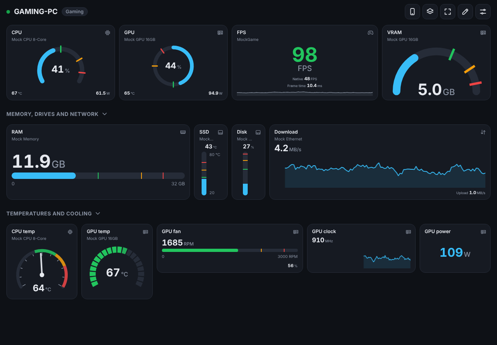
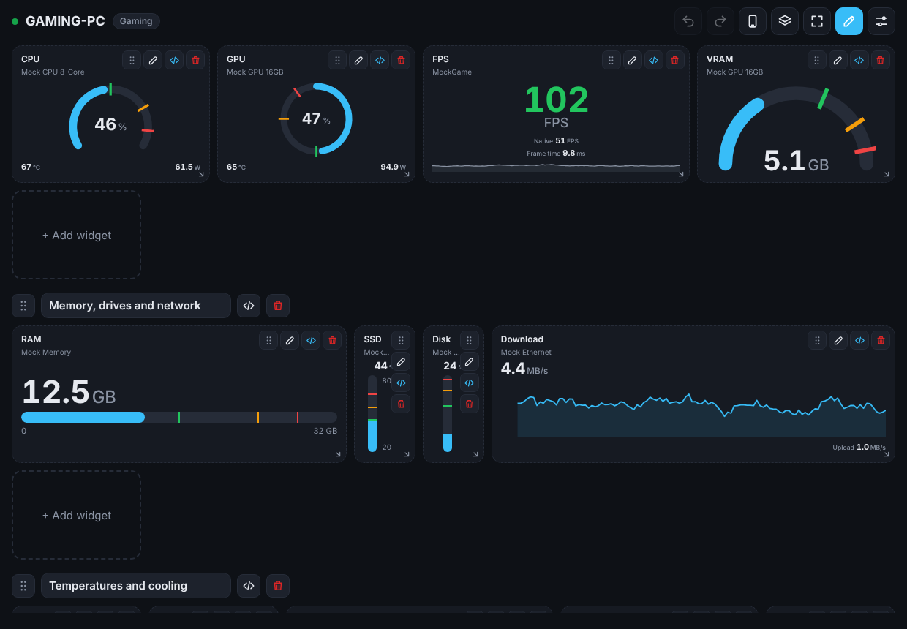
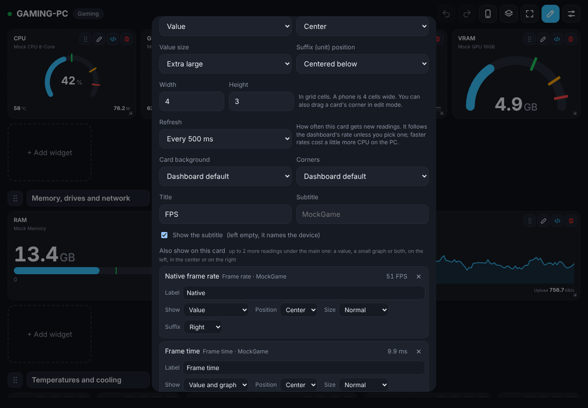
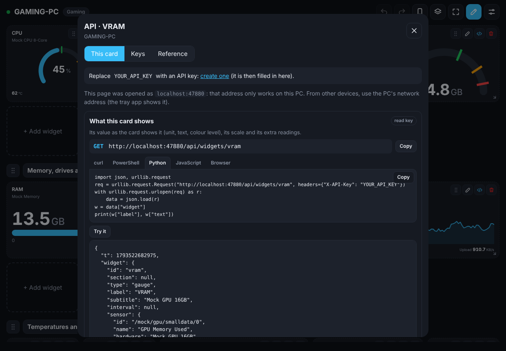

# SYSCOM · System Companion

[](https://github.com/rotate4all/syscom/actions/workflows/ci.yml)
[](https://github.com/rotate4all/syscom/releases/latest)
[](LICENSE)

SYSCOM turns any phone, tablet or PC browser into a live hardware monitor for the computers on your network.
Install it on each Windows PC you want to watch. It runs quietly in the background and streams temperatures,
loads, clocks, fan speeds, memory, disk and network activity, and FPS. Open it from any browser, sign in, and
swipe between your machines.

There's no app to install on the phone and no GPU-Z, Afterburner or RivaTuner running in the background. Sensors
come from a single open-source library, everything SYSCOM needs ships in one setup, and each piece updates itself.
It's light enough to leave running while you game, even with the dashboard refreshing twice a second
([numbers below](#light-on-your-pc)).

<p align="center">
  
</p>
<p align="center">
  
  &nbsp;
  
  &nbsp;
  
</p>

> The screenshots use SYSCOM's built-in mock sensors (`--mock`); on a real PC you see your own hardware names.

**Contents:** [Highlights](#highlights) · [The dashboard](#the-dashboard) · [API](#api) ·
[Light on your PC](#light-on-your-pc) · [What it monitors](#what-it-monitors) · [Install](#install) ·
[Using it](#using-it) · [Phone app](#install-it-as-a-phone-app) · [Updating](#updating) ·
[Building](#building-from-source) · [Roadmap](#roadmap)

## Highlights

- **Server-only, any browser as the client.** Each PC runs SYSCOM, and any device on the network opens
  `http://<pc>:47810`. Nothing to install on phones, though you can install the dashboard as an app.
- **Many PCs, one dashboard.** Add every SYSCOM machine you own and swipe between them. SYSCOM PCs find each other
  on the network by themselves.
- **A dashboard you design**, per PC and saved on that PC, with separate desktop and phone layouts.
  [Five card types, five gauge styles](#cards), sections, drag and resize, thresholds with colours, and each card
  refreshing at its own pace.
- **30 days of history** for every sensor, one tap away.
- **An API with keys** for scripts, Home Assistant, a Stream Deck or a Raspberry Pi display. Every card, section
  and dashboard has an **API** button with ready-to-run examples.
- **A normal Windows setup**, with an Installed apps entry and uninstaller. It updates itself afterwards.
- **Monitoring only.** No fan control, no overclocking, nothing that writes to your hardware. Nothing is injected
  into games, so it's safe with anti-cheat.

## The dashboard

### Cards

| Card | What it shows | Options of its own |
| --- | --- | --- |
| **Gauge** | the reading on a dial | five styles: *Arc*, *Semicircle*, *Ring*, *Needle* and *Segments*; value at the top, center or bottom; arc thickness |
| **Bar** | a horizontal bar | value above, beside or inside the bar; min/max labels shown or hidden (the bar then stays centered); bar thickness |
| **Vertical bar** | a narrow column, good for drives side by side | value above, below, beside or inside; min/max labels; bar thickness |
| **Graph** | a live line graph | the current value above it, or the graph alone; line thickness |
| **Value** | a big number, like FPS | left, center or right |

Every card also has:

- **Up to 2 more readings** under the main one (say CPU load with its temperature and power), each as a number, a
  small graph or both, on the left, in the center or on the right, in one of five sizes, with your own label.
- **Min / med / max thresholds**, each with its own colour (green, amber, red, or reversed for FPS). The card takes
  the colour of the highest threshold the reading has reached.
- **Its own refresh rate**: every 500 ms to every 60 s, or (by default) whatever the dashboard uses. A frame-time
  graph can update twice a second while drive space updates once a minute.
- The number in one of five sizes, with its unit beside, above or below it, or hidden; B to TB for sizes, KB/s to
  GB/s or Mbit/s for data rates; 0 to 2 decimals; a fixed or automatic scale.
- Title and subtitle (the subtitle names the device unless you change it), transparency and corner rounding.
- A **live sensor picker**: device tabs (CPU, GPU, Game, Memory, Drives, …), reading types under the active tab,
  and every sensor's current value in the list, plus search.

<p align="center">
  
  &nbsp;
  
</p>

### Layout

- **Drag cards** to reorder them (on a touch screen, by their ⠿ handle) and **drag a corner** to resize them. The
  content scales with the card.
- **Sections** group cards under a title; drag a section to move it with its cards, tap its title to fold it away.
- **A suggested layout** to start from: CPU, GPU, FPS with native frame rate and frame time, VRAM, RAM, drives and
  network, picked from the sensors your PC actually has.
- **Desktop and phone layouts** per PC, each with its own cards and sections. The phone layout starts as a copy of
  the desktop one; the phone preview on a PC lets you prepare it at phone width.
- **Saved layouts**: save the layout on screen under a name (say *Gaming* and *Work*) and switch with one click.
- **Export and import** one layout to a file. Importing on another PC matches each reading to that PC's sensors.
- **Undo and redo** the last 5 edits (Ctrl+Z, Ctrl+Y).

### Look

- Light, dark or automatic theme.
- A colour or a picture behind the dashboard, see-through cards, square or rounded corners (per dashboard, and per
  card).
- **Smooth animations**: gauges and bars glide to each new reading, numbers count and graphs scroll steadily, each
  card at its own refresh rate. *Follow system* turns them off when Windows or the phone asks for less motion,
  *Off* turns them off.
- **Full screen** without the top bar, for a tablet or an old phone on the desk. The screen stays on while the
  dashboard is open (phones and tablets by default).

### History

Tap any card for a chart of the last 1, 3, 7, 14 or 30 days: the average as a line, the lowest to highest reading
as a band, and exact values when you hover or touch it. Every sensor is kept for 30 days, whether or not it's on a card
(about 75 MB on disk for 600 sensors).

## API

Everything the dashboard shows can be read by scripts and other apps, with an API key: every sensor with its live
value, sensors by category (all GPU temperatures, every fan), the history, and the dashboard itself card by card, in
the same units and colours the cards show. A full-access key can also change the dashboard.

```bash
curl -H "X-API-Key: syscom_…" "http://192.168.1.20:47810/api/sensors?category=gpu&kind=temperature"
curl -H "X-API-Key: syscom_…" "http://192.168.1.20:47810/api/dashboard/readings"
```

You don't need to read the reference first: build what you want in the dashboard, then open the **API** button on a
card, a section or the whole dashboard. It shows the exact address and ready-to-run examples (curl, PowerShell,
Python, JavaScript, browser) for that card, filled in with your PC's address and your key, and **Try it** shows the
answer. The same window creates and revokes keys and holds the full reference.

<p align="center">
  
</p>

The full reference, generated from the same source as the in-app one, is in [docs/API.md](docs/API.md).

## Light on your PC

SYSCOM is built to stay out of the way of the games and work it monitors:

- **Nothing is drawn on the monitored PC.** No window to repaint, no overlay, nothing hooked into games. The
  dashboard runs on the phone or browser that shows it; the PC only reads sensors and sends small JSON frames.
- **One reading for everyone.** However many dashboards are open, the PC reads its sensors once per interval (the
  fastest any card asks for) and sends each dashboard only the sensors its cards show.
- **Quiet when nobody's watching.** With no dashboard open, it reads every 2 s for the history (or not at all, with
  history turned off).
- **One native service.** No browser engine, Electron, Node.js or Python on the PC: a .NET service, plus a small tray
  app.

<!-- benchmark:start -->
Measured with `build\benchmark.ps1` by CI on a GitHub Actions Windows runner (AMD EPYC 7763, 4 vCPUs, 16 GB, no GPU,
113 sensors), 60 s per row after a 30 s warm-up, SYSCOM 0.18.0:

| What's running | CPU, whole PC | CPU, one core | Memory (private) | Memory (working set) | Sent to the dashboard |
| --- | --- | --- | --- | --- | --- |
| SYSCOM, no dashboard open (history every 2 s) | 0.32 % | 1.3 % | 39 MB | 104 MB | none |
| SYSCOM, a dashboard showing every sensor every 1 s | 0.23 % | 0.9 % | 39 MB | 105 MB | 0.4 KB/s |
| SYSCOM, a dashboard showing every sensor every **500 ms** | 0.24 % | 1.0 % | 44 MB | 111 MB | 0.8 KB/s |
| *For comparison:* LibreHardwareMonitor 0.9.6's own app (window open, its default 1 s) | 0.49 % | 2.0 % | 39 MB | 101 MB | |

At 500 ms, SYSCOM uses about a quarter of a percent of the PC's CPU: half of what LibreHardwareMonitor's own app uses
at 1 s, reading the same sensors through the same library, and about the same memory. Private memory is what SYSCOM
itself holds; the working set also counts the .NET runtime's shared code. Differences of about 0.1 % are run-to-run
noise. A gaming PC with a GPU and motherboard sensors has several times more sensors to read, so measure yours too.
<!-- benchmark:end -->

Measure it on your own PC with [build/benchmark.ps1](build/benchmark.ps1) (run as administrator; it changes
nothing). Add `-Compare` with another monitoring app's process name (`HWiNFO64`, `MSIAfterburner`, …) or the path of
its .exe to measure it the same way, side by side:

```powershell
pwsh -ExecutionPolicy Bypass -File benchmark.ps1 -Key syscom_… -Compare HWiNFO64
```

## What it monitors

| Area | Sensors |
| --- | --- |
| CPU | total and per-core load, clocks, package/core temperatures, power, voltages |
| GPU (NVIDIA, AMD, Intel) | core/memory load, clocks, temperatures, hot spot, fan speed, power (W, and % of the power limit on NVIDIA), VRAM used/free/total and used in %, both as the driver reports it and as Windows (Task Manager) counts it |
| Memory | load, used/available |
| Storage | temperatures (SMART), activity, read/write rates, used space, free/total space per drive |
| Motherboard | fan speeds, voltages, temperatures via Super I/O |
| Network | upload/download speed, data transferred |
| Other | battery, PSU (where supported) |
| Games | frame rate (shown and native), frame time and worst frame time of the app drawing the most frames, on any GPU (see below) |

Frame rate comes from SYSCOM's own counter on Windows' graphics present events (Microsoft-Windows-DXGI and -D3D9,
the same events PresentMon and FrameView use). Nothing is injected into games, so it's safe with anti-cheat. It
covers Direct3D 9 to 12, plus Vulkan/OpenGL games whose driver presents through DXGI. The card shows which app
it's measuring.

With frame generation, **Frame rate** counts every frame shown, generated ones included, and **Native frame rate**
the frames the game renders itself. The native count comes from public trace events too: NVIDIA Reflex's PC
Latency Stats (every game with DLSS Frame Generation has Reflex), and the frame types Intel XeSS Frame Generation
and AMD Fluid Motion Frames report. FSR 3 frame generation in a game without Reflex can't be told apart; there,
and without frame generation, both show the same number.

Sensors come from [LibreHardwareMonitor](https://github.com/LibreHardwareMonitor/LibreHardwareMonitor), the
one hardware dependency. It covers what GPU-Z and MSI Afterburner report, without running either. Exactly what
appears depends on your hardware.

## Install

1. Download **`SYSCOM-Setup-<version>.exe`** from [the latest release](https://github.com/rotate4all/syscom/releases/latest)
   and run it.
2. Windows may show *Windows protected your PC*, because the setup isn't code-signed yet. Click **More info**, then
   **Run anyway**.
3. Follow the setup. At the end, the SYSCOM window opens with the dashboard's addresses and the first password.
   Open one of the addresses (for example `http://192.168.1.20:47810`) on your phone, or scan the QR code that
   **Set up phone…** shows, and sign in. Change the password from the same window.

If the phone can't open the address (Chrome on Android shows errors such as `ERR_TOO_MANY_RETRIES` or
`ERR_ADDRESS_UNREACHABLE`), the browser isn't allowed to reach devices on your network yet. On Android, give Chrome
the **Nearby devices** permission (Settings → Apps → Chrome → Permissions). On iPhone, browsers other than Safari
need **Local Network** access (Settings → Privacy & Security → Local Network).

The setup puts SYSCOM in `C:\Program Files\SYSCOM`, registers the **SYSCOM** Windows service (starts at boot),
opens TCP 47810 (HTTP), TCP 47812 (HTTPS) and UDP 47811 (discovery) on private networks only, installs or updates
the PawnIO driver if needed, and starts the tray app at sign-in. Start menu → **SYSCOM** opens the tray app's window,
**SYSCOM dashboard** the dashboard. Running a newer setup over an installed SYSCOM upgrades it and keeps your
settings, dashboards and keys. Uninstall it from Settings → Apps → Installed apps; it asks whether to keep your
settings and history.

**Requirements:** Windows 10 (1809 or newer) or Windows 11, x64. Nothing else: the .NET runtime is included.

<details><summary>Unattended install, and the zip with scripts</summary>

`SYSCOM-Setup-<version>.exe /VERYSILENT /SUPPRESSMSGBOXES` installs without questions (add `/LOG="setup.log"` for a
log); `"C:\Program Files\SYSCOM\unins000.exe" /VERYSILENT` removes it and keeps the settings.

Each release also has `SYSCOM-<version>-win-x64.zip` with `install.ps1` and `uninstall.ps1`, which do the same as the
setup from PowerShell. Windows marks downloaded files, so unblock the zip before extracting it (right-click →
Properties → **Unblock**, or `Unblock-File`), then right-click `install.ps1` → **Run with PowerShell**.
</details>

### Why administrator rights and a driver?

CPU temperatures and motherboard sensors can only be read from kernel mode. LibreHardwareMonitor does that through
[PawnIO](https://pawnio.eu), a small signed driver. The setup installs the bundled PawnIO version, or updates yours
if it's older. The tray app warns you if PawnIO is ever missing or older than the minimum safe version (older
drivers had security issues). GPU, load, memory, disk and network sensors work without it.

## Using it

- **First visit:** the dashboard is empty. Tap **Suggested layout** to get CPU, GPU, FPS, RAM, disk and network
  cards, or **Add widget** to pick sensors yourself.
- **Edit:** tap the pencil to enter edit mode. Drag a card to move it, drag its bottom-right corner to resize it,
  ✎ edits it, `</>` opens its API window and 🗑 removes it. **+ Add section** adds a titled group.
- **Refresh rate:** Settings → per device, *Every …* (500 ms to 10 s; 1 s by default). A card's own *Refresh* in
  its editor overrides it for that card.
- **Phone layout:** on a PC, the phone button next to the pencil shows and edits the phone layout at phone width
  (4 cells across). It becomes separate from the desktop one with the first change made there; **↺ Use the desktop
  layout** in edit mode goes back.
- **History:** tap a card. The slider picks the last 1, 3, 7, 14 or 30 days.
- **More PCs:** Settings → *Add device*. PCs found on your network are listed, or you can type an address. Swipe
  left or right (or use the arrow keys) to switch.
- **Layouts:** the layers button saves the layout on screen under a name, switches between saved layouts, and
  exports or imports one layout (desktop or phone) of the PC on screen.
- **Appearance:** Settings → *Appearance…* (or in edit mode) sets the background, card transparency, corners and
  animations.
- **API keys:** Settings → *API keys and reference…*, or any API window.
- **Full screen:** the corners button (or F) hides the top bar; tap the screen and use the button in the corner, or
  press Esc, to leave.

### Install it as a phone app

Phones only install web apps from secure (HTTPS) addresses, and a PC at home has no public certificate. So each
SYSCOM PC creates its own small certificate authority, and your phone trusts it once:

1. On the PC: SYSCOM tray icon → **Set up phone…**, and scan the QR code with the phone's camera.
2. The setup page that opens (`http://<pc>:47810/trust`) downloads the certificate and shows the steps for your
   phone: iPhone/iPad, Android, Windows or Mac. Its fingerprint matches the one in the tray window.
3. Tap **Open secure dashboard** (`https://<pc>:47812`), sign in, then *Add to Home Screen* (iPhone) or
   *Install app* (Android).

The certificate is name-constrained to private network addresses, `localhost`, `*.local` and the PC's own name, so
it can't vouch for any other website. The PC renews its HTTPS certificate by itself when its address changes, and the
phone doesn't need to do anything again. Monitoring several PCs from the app: trust each PC once from its own setup
page. The secure dashboard then talks to every PC over HTTPS.

Without the certificate, *Add to Home Screen* still works over plain HTTP: iPhone opens it full screen, Android
creates a shortcut that opens in Chrome.

Each PC keeps its own dashboard, so a layout you prepare on your PC is what the phone shows. The list of PCs is kept
on the PC the dashboard was opened from, so every address of that PC (and every browser) finds the same PCs. From
the secure dashboard, adding another PC needs no second certificate: if the phone doesn't trust that PC, the first
PC relays to it on the LAN.

## Updating

The **tray app** (notification area → SYSCOM icon → *Manage SYSCOM…*, or Start menu → SYSCOM) lists every
component with its installed version, the latest version and its health:

| Component | Updated from |
| --- | --- |
| SYSCOM (server, updater, tray app) | this repository's GitHub releases |
| Web dashboard | this repository's GitHub releases (applied live, no restart) |
| LibreHardwareMonitor | nuget.org |
| PawnIO driver | PawnIO's official GitHub releases |
| .NET runtime | Microsoft's official release feed (patch updates) |

**Update selected** or **Update all** downloads each piece, verifies its publisher's checksum, stops the service,
swaps the files, restarts and checks health. If SYSCOM doesn't come back healthy, the previous files are restored
automatically. The tray app restarts itself after an update of SYSCOM.

By default each PC also installs new SYSCOM and dashboard releases **by itself**: it checks every 6 hours, and an
update that restarts SYSCOM waits until no dashboard is open (at most a day). *Install updates automatically* in the
tray app's window switches between SYSCOM and its dashboard, every component, or notifications only. Every merge
that bumps the version publishes a release here, which is what the PCs pick up. Details are in
[docs/UPDATES.md](docs/UPDATES.md).

## Building from source

```powershell
winget install Microsoft.DotNet.SDK.10
git clone https://github.com/rotate4all/syscom
cd syscom
pwsh build\package.ps1          # → dist\SYSCOM-Setup-<ver>.exe, dist\SYSCOM-<ver>-win-x64.zip, update assets
```

The script fetches the pinned [Inno Setup](https://jrsoftware.org/isinfo.php) compiler by itself for the setup.
For development you can run the server with fake sensors on any OS (`dotnet run --project src/Syscom.Server -- --mock`)
and edit `web/` with no build step. See [docs/BUILDING.md](docs/BUILDING.md).

## Documentation

- [API](docs/API.md): keys, every endpoint with examples, the WebSocket stream
- [Architecture](docs/ARCHITECTURE.md): how the pieces fit together
- [Updates and releases](docs/UPDATES.md): component updates, rollback, feed format, cutting a release
- [Building](docs/BUILDING.md): dev setup, packaging, the setup, project layout
- [Changelog](CHANGELOG.md)
- [Security](SECURITY.md): threat model and how to report a vulnerability

## Roadmap

- **Linux release**: the server, its dashboard and the API on Linux (LibreHardwareMonitor's Linux support plus the
  kernel's hwmon sensors), packaged for the common distributions and running as a systemd service.
- A code-signed setup and a `winget install` package, so Windows stops warning about the download.
- Frame rate for Vulkan/OpenGL games that don't present through DXGI (graphics kernel events).
- Per-card history length and min/max markers on graphs.

## Credits and license

SYSCOM is licensed under the [GNU GPL v3](LICENSE). It builds on LibreHardwareMonitor (MPL-2.0), PawnIO and
.NET (MIT); the setup is made with [Inno Setup](https://jrsoftware.org/isinfo.php). See
[THIRD-PARTY-NOTICES.md](THIRD-PARTY-NOTICES.md). Inspired by PITIKAPP.
