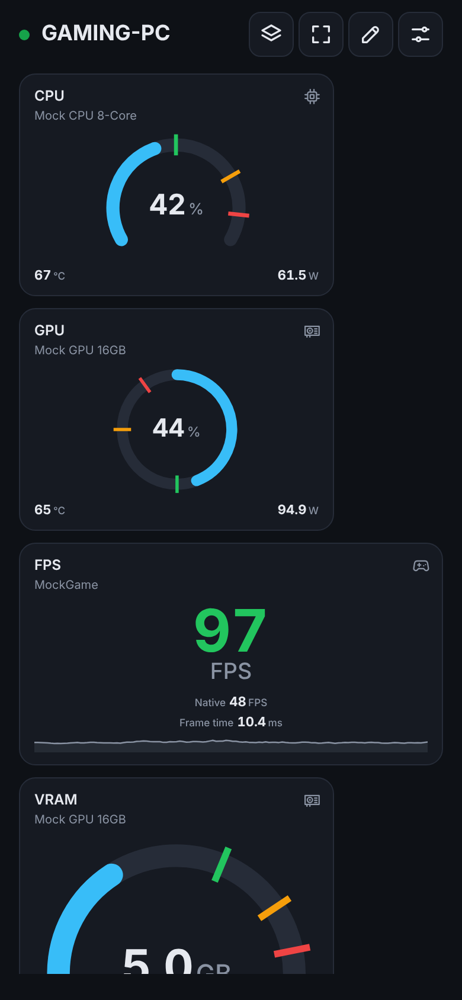
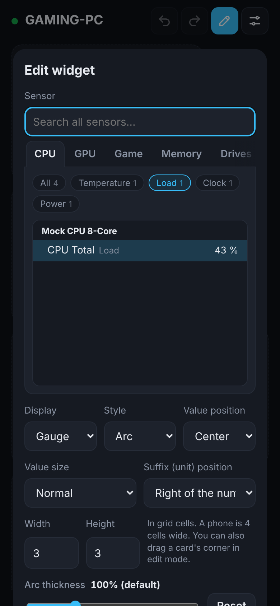
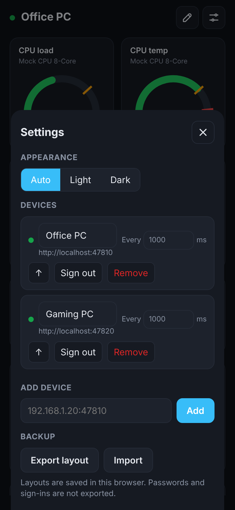
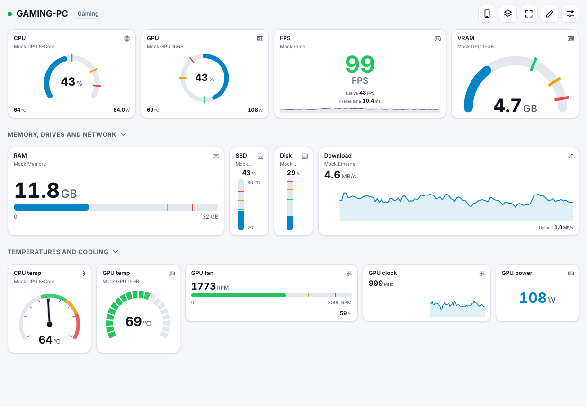

# SYSCOM · System Companion

[](https://github.com/rotate4all/syscom/actions/workflows/ci.yml)
[](LICENSE)

SYSCOM turns any phone, tablet or PC browser into a live hardware monitor for the computers on your network.
Install it on each Windows PC you want to watch. It runs quietly in the background and streams temperatures,
loads, clocks, fan speeds, memory, disk and network activity, and FPS. Open it from any browser, sign in, and
swipe between your machines.

There's no app to install on the phone and no GPU-Z, Afterburner or RivaTuner running in the background. Sensors
come from a single open-source library, and everything SYSCOM needs ships in one package that updates itself
component by component.

<p align="center">
  
  &nbsp;
  
  &nbsp;
  
</p>
<p align="center">
  
</p>

> The screenshots use SYSCOM's built-in mock sensors (`--mock`); on a real PC you see your own hardware names.

## Features

- **Server-only, any browser as the client.** Each PC runs SYSCOM, and any device on the network opens
  `http://<pc>:47810`. Nothing to install on phones, though you can install the dashboard as an app.
- **Many PCs, one dashboard.** Add every SYSCOM machine you own and swipe between them. SYSCOM servers find each
  other on the LAN automatically.
- **A configurable dashboard per PC, saved on that PC.** Five gauge styles, horizontal and vertical bars, live graphs
  and big numbers, grouped in sections. Drag cards to reorder them, drag a corner to resize them (the content scales
  with the card, bar and line thickness included, and can be made thinner or thicker per card), choose where the value
  sits, put up to 3 sensors on one card (say CPU load with its power draw, each as a number, a small graph or both, on the
  left, in the center or on the right, in one of five sizes, with your own label and the unit beside, above or below
  the number or hidden; big numbers such as FPS get the same alignment, size and unit options),
  rename titles and subtitles, and start from a suggested layout. Every browser and phone that signs
  in sees the same layouts. Each PC has a desktop layout and a separate phone layout (its own cards, sensors and
  sections), and the phone preview lets you prepare the phone one from your PC.
- **30 days of history for every sensor.** Tap any card for a chart of the last 1, 3, 7, 14 or 30 days, with the
  lowest, average and highest readings.
- **Min / med / max thresholds** per widget, each with its own colour (for example green, amber, red, or reversed for
  FPS).
- **Polling you control:** 1 s by default, down to 500 ms, set per PC. With nobody watching, a server reads its
  sensors every 2 s for the history (or not at all, with history turned off).
- **Light, dark or automatic theme.**
- **Installable phone app.** Scan a QR code from the tray app; the phone trusts that PC's own certificate once and
  installs the dashboard as an app over HTTPS. No cloud account, no public domain.
- **Password sign-in** per PC, with signed tokens and lockout after repeated failures.
- **Monitoring only.** No fan control, no overclocking, nothing that writes to your hardware.
- **A tray app** that shows the health of every component, checks for updates and installs them with one click,
  with automatic rollback if an update misbehaves.

## What it monitors

| Area | Sensors |
| --- | --- |
| CPU | total and per-core load, clocks, package/core temperatures, power, voltages |
| GPU (NVIDIA, AMD, Intel) | core/memory load, clocks, temperatures, hot spot, fan speed, power (W, and % of the power limit on NVIDIA), VRAM used/free/total and used in %, both as the driver reports it and as Windows (Task Manager) counts it |
| Memory | load, used/available |
| Storage | temperatures (SMART), activity, read/write rates, used space, free/total space per drive |
| Motherboard | fan speeds, voltages, temperatures via Super I/O |
| Network | upload/download speed, data transferred |
| Other | battery, PSU (where supported) |
| Games | frame rate (shown and native), frame time and worst frame time of the app drawing the most frames, on any GPU (see below) |

Frame rate comes from SYSCOM's own counter on Windows' graphics present events (Microsoft-Windows-DXGI and -D3D9,
the same events PresentMon and FrameView use). Nothing is injected into games, so it's safe with anti-cheat. It
covers Direct3D 9 to 12, plus Vulkan/OpenGL games whose driver presents through DXGI. The widget shows which app
it's measuring.

With frame generation, **Frame rate** counts every frame shown, generated ones included, and **Native frame rate**
the frames the game renders itself. The native count comes from public trace events too: NVIDIA Reflex's PC
Latency Stats (every game with DLSS Frame Generation has Reflex), and the frame types Intel XeSS Frame Generation
and AMD Fluid Motion Frames report. FSR 3 frame generation in a game without Reflex can't be told apart; there,
and without frame generation, both show the same number.

Sensors come from [LibreHardwareMonitor](https://github.com/LibreHardwareMonitor/LibreHardwareMonitor), the
one hardware dependency. It covers what GPU-Z and MSI Afterburner report, without running either. Exactly what
appears depends on your hardware.

## Install

1. Download `SYSCOM-<version>-win-x64.zip` from [Releases](https://github.com/rotate4all/syscom/releases) and extract it.
2. Right-click `install.ps1` and choose **Run with PowerShell**. It asks for administrator rights.
3. Open one of the printed addresses (for example `http://192.168.1.20:47810`) on your phone and sign in with the
   printed password. Change it from the SYSCOM tray icon.

If the phone can't open the address (Chrome on Android shows errors such as `ERR_TOO_MANY_RETRIES` or
`ERR_ADDRESS_UNREACHABLE`), the browser isn't allowed to reach devices on your network yet. On Android, give Chrome
the **Nearby devices** permission (Settings → Apps → Chrome → Permissions). On iPhone, browsers other than Safari
need **Local Network** access (Settings → Privacy & Security → Local Network).

The installer puts SYSCOM in `C:\Program Files\SYSCOM`, registers the **SYSCOM** Windows service, opens TCP 47810
(HTTP), TCP 47812 (HTTPS) and UDP 47811 on private networks only, installs or updates the PawnIO driver if needed, and starts the tray app at
logon. Remove it with `uninstall.ps1` in the same folder.

**Requirements:** Windows 10/11 x64. Nothing else: the .NET runtime is bundled in the package.

### Why administrator rights and a driver?

CPU temperatures and motherboard sensors can only be read from kernel mode. LibreHardwareMonitor does that through
[PawnIO](https://pawnio.eu), a small signed driver. The installer installs the bundled PawnIO version, or updates
yours if it's older. The tray app warns you if PawnIO is ever missing or older than the minimum safe version
(older drivers had security issues). GPU, load, memory, disk and network sensors work without it.

## Using it

- **First visit:** the dashboard is empty. Tap **Suggested layout** to get CPU, GPU, RAM, disk and network
  widgets, or **Add widget** to pick sensors yourself.
- **Edit:** tap the pencil to enter edit mode. Drag a card to move it (on a touch screen, drag it by its ⠿ handle),
  drag its bottom-right corner to resize it, ✎ edits it (sensor, with every sensor's live reading in the list;
  display, style, value position, size, thickness, title and subtitle, unit (B to TB for sizes, KB/s to GB/s or Mbit/s for
  data rates), more readings on the card, scale, thresholds) and 🗑 removes it. **+ Add section** adds a titled group; drag a section by its handle to move it with
  its cards. Outside edit mode, tap a section title to fold it away.
- **Phone layout:** phones have their own layout. On a PC, the phone button next to the pencil shows and edits it at
  phone width (4 cells across). It starts as the desktop layout and becomes separate with the first change made
  there; **↺ Use the desktop layout** in edit mode goes back.
- **History:** tap a card. The slider picks the last 1, 3, 7, 14 or 30 days (1 day when it opens). The line is the
  average and the band behind it the lowest to highest reading; hover or touch the chart for exact values.
- **Thresholds:** each widget has *min*, *med* and *max* values with a colour each. The widget takes the colour of the
  highest threshold the reading has reached. Leave a value empty to turn it off.
- **More PCs:** Settings → *Add device*. PCs found on your network are listed, or you can type an address. Swipe
  left or right (or use the arrow keys) to switch.
- **Polling:** Settings → per device, *Every … ms* (minimum 500).
- **Backup:** Settings → *Export layout* saves your dashboards to a file you can import later or elsewhere.

### Install it as a phone app

Phones only install web apps from secure (HTTPS) addresses, and a PC at home has no public certificate. So each
SYSCOM PC creates its own small certificate authority, and your phone trusts it once:

1. On the PC: SYSCOM tray icon → **Set up phone…**, and scan the QR code with the phone's camera.
2. The setup page that opens (`http://<pc>:47810/trust`) downloads the certificate and shows the steps for your
   phone: iPhone/iPad, Android, Windows or Mac. Its fingerprint matches the one in the tray window.
3. Tap **Open secure dashboard** (`https://<pc>:47812`), sign in, then *Add to Home Screen* (iPhone) or
   *Install app* (Android).

The certificate is name-constrained to private network addresses, `localhost`, `*.local` and the PC's own name, so
it can't vouch for any other website. The PC renews its HTTPS certificate by itself when its address changes, and the
phone doesn't need to do anything again. Monitoring several PCs from the app: trust each PC once from its own setup
page. The secure dashboard then talks to every PC over HTTPS.

Without the certificate, *Add to Home Screen* still works over plain HTTP: iPhone opens it full screen, Android
creates a shortcut that opens in Chrome.

Each PC keeps its own dashboard, so a layout you prepare on your PC is what the phone shows. The list of PCs and the
theme are kept per browser and per address (HTTP and HTTPS count as different addresses): open the dashboard from the
same PC address each time, and add the other PCs from there.

## Updating

The **tray app** (notification area → SYSCOM icon → *Manage SYSCOM…*) lists every component with its installed
version, the latest version and its health:

| Component | Updated from |
| --- | --- |
| SYSCOM (server, updater, tray app) | this repository's GitHub releases |
| Web dashboard | this repository's GitHub releases (applied live, no restart) |
| LibreHardwareMonitor | nuget.org |
| PawnIO driver | PawnIO's official GitHub releases |
| .NET runtime | Microsoft's official release feed (patch updates) |

**Update selected** or **Update all** downloads each piece, verifies its publisher's checksum, stops the service,
swaps the files, restarts and checks health. If SYSCOM doesn't come back healthy, the previous files are restored
automatically. Details are in [docs/UPDATES.md](docs/UPDATES.md).

## Building from source

```powershell
winget install Microsoft.DotNet.SDK.10
git clone https://github.com/rotate4all/syscom
cd syscom
pwsh build\package.ps1          # → dist\SYSCOM-<ver>-win-x64.zip plus update assets
```

For development you can run the server with fake sensors on any OS (`dotnet run --project src/Syscom.Server -- --mock`)
and edit `web/` with no build step. See [docs/BUILDING.md](docs/BUILDING.md).

## Documentation

- [Architecture](docs/ARCHITECTURE.md): how the pieces fit together
- [API and protocol](docs/API.md): HTTP endpoints and the WebSocket stream
- [Updates and releases](docs/UPDATES.md): component updates, rollback, feed format, cutting a release
- [Building](docs/BUILDING.md): dev setup, packaging, project layout
- [Security](SECURITY.md): threat model and how to report a vulnerability

## Roadmap

- Frame rate for Vulkan/OpenGL games that don't present through DXGI (graphics kernel events).
- Per-widget history length and min/max markers on graphs.

## Credits and license

SYSCOM is licensed under the [GNU GPL v3](LICENSE). It builds on LibreHardwareMonitor (MPL-2.0), PawnIO and
.NET (MIT). See [THIRD-PARTY-NOTICES.md](THIRD-PARTY-NOTICES.md). Inspired by PITIKAPP.
